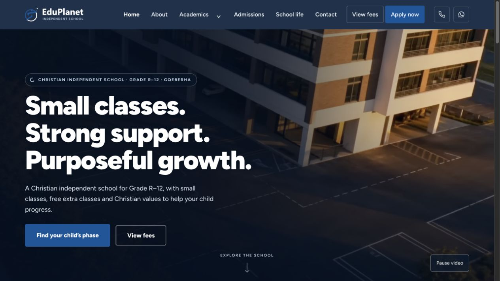

# EduPlanet UX improvements prepared for review

20 October 2026. Implemented in the current local checkout; nothing was pushed or deployed during this work.

## Latest owner revisions

The video control has been removed, Academics now says “Select your child’s phase”, and Admissions now has three steps. Step 1 uses the restored online/PDF wording and Apply now / Download the PDF form actions. Former steps 3–4 are combined under “Secure your child’s place at EduPlanet” using the owner’s exact two paragraphs. The PDF button opens a helpful accounts-office panel until the current PDF URL is supplied. These revisions supersede the earlier video-control and paper-application-button notes below.

## What changed

- Added shared **View fees** access in navigation and the footer on all ten pages. Home now leads with phase discovery and fees. Removed the redundant hero summary line to keep the first screen concise.
- Kept every **Apply now** action linked directly to the existing Google application form. Fees remain ungated; no contact-details popup was restored.
- Made the fee popup title, close control and Apply action stay visible while its contents scroll. Kept the grade dropdown, the exact 35 supplied fee amounts and the expandable benefits. The selected grade is remembered within the browser session; contact details are not stored there.
- Changed the secondary scholarship action to **Register scholarship interest**, retaining the strong-academic-performer condition and third-party availability/eligibility wording. Existing email submission handling and truthful success/error behaviour remain in place.
- Replaced placeholder appointment controls with **Request an appointment** links to a clear Contact section. That section offers the existing school WhatsApp number with a prepared request, plus accounts email. It explains that the school must confirm a time. No message is automatically sent.
- Replaced the unavailable PDF download with **Request a paper application**, opening an email to the accounts office. Approved PDF/calendar URLs can be connected later through configuration.
- Preserved the four admissions steps, including the preferred wording of steps three and four. Added a short parent FAQ. Kept the complete on-page benefits and the shorter popup summary. Stationery and optional aftercare arrangements are distinguished from tuition inclusions.
- Gave each phase distinct headings and more focused supporting text. Shortened the Senior hero, corrected the FET subject FAQ, aligned Foundation/Intermediate/Senior/FET naming and added quiet appointment links. Used the existing approved netball image to vary Senior imagery.
- Made button wording and the footer consistent, using the supplied “Belong. Grow. Make a Difference.” sign-off. Preserved the owner's recent “Select your child’s stage” edit on Academics.
- Added a visible video play/pause control. Mobile, reduced-motion and data-saving visits start with the poster; a manual pause is respected when scrolling away and back.
- Prepared production search-indexing cleanup, individual page descriptions, canonical URLs, a sitemap and robots.txt. An explicit private-preview build mode remains available.
- Added a helpful 404 page with recovery actions and Vercel redirects for 20 legacy school routes plus two former sitemap URLs. Four old routes still need approved current content. The local Python server does not apply Vercel routing rules; deployment routing must be checked on the host.
- Kept review reports out of both Vercel and GitHub Pages uploads. Added release checks to the existing Pages workflow and updated the source/build documentation.

## Preserved and checked

- The official vision, mission and all nine values match the previous version exactly.
- All 35 supplied fee amounts are unchanged.
- All ten page/section links, shared dialog IDs, application destinations, canonical URLs, descriptions and configured redirect destinations pass the release check.
- Ten automated popup checks pass, including email failure handling, no fee contact collection, selected-grade retention and mobile-menu focus return. Tests use simulated provider responses, not real enquiries.
- Browser checks covered all ten pages at 360 px width with no horizontal document overflow. Desktop navigation was also inspected at 1100 px and the normal desktop viewport.
- Fee selection, inclusions, nested scholarship interest, close/Escape behaviour, mobile navigation, focus return and the video pause control were checked in the browser. No real application, scholarship enquiry or appointment request was submitted.
- Public and private-preview build modes both passed validation. The files were restored to public-release mode afterwards. No publication occurred.

## Still needs owner information or external access

1. **Google Form editing:** remove Grade RR; review the application title, duplicate contact fields, academic-performance wording, optional research questions, second page and confirmation. No editor access is available in this workspace.
2. **PDF/calendar:** supply a current approved application PDF and booking calendar if wanted. Working paper-application and appointment-request routes are already provided.
3. **School specifics and proof:** confirm aftercare arrangements, phase entry requirements, document checklist, subject combinations and examination-board details. Supply approved results, credentials, testimonials and reels before adding new claims/media.
4. **Email verification:** activation is owner-confirmed, but actual scholarship email arrival at info@eduplanet.co.za still needs an inbox check.
5. **Measurement:** an analytics account and access to completed application/appointment records are needed to measure conversion. No tracking service has been added.
6. **Remaining legacy content:** facilities, important documents, parent testimonials and uniform guidance need current approved information before specific replacement sections/redirects can be completed.
7. **Publication:** review locally, then publish through the existing authorised Git/hosting workflow and verify the public application action, indexing and redirects. The older live website has not changed during this implementation.

## Preview

- [Home](http://127.0.0.1:8001/)
- [Admissions and full benefits](http://127.0.0.1:8001/admissions.html)
- [Fee popup](http://127.0.0.1:8001/admissions.html?view=fees#fees)
- [Appointment request](http://127.0.0.1:8001/contact.html#appointment)

[Mobile fee-popup screenshot](ux-improvements-2026-10-20/mobile-fees.png)

Build and connection instructions: [release preparation](../tools/publish-focused/README.md).
